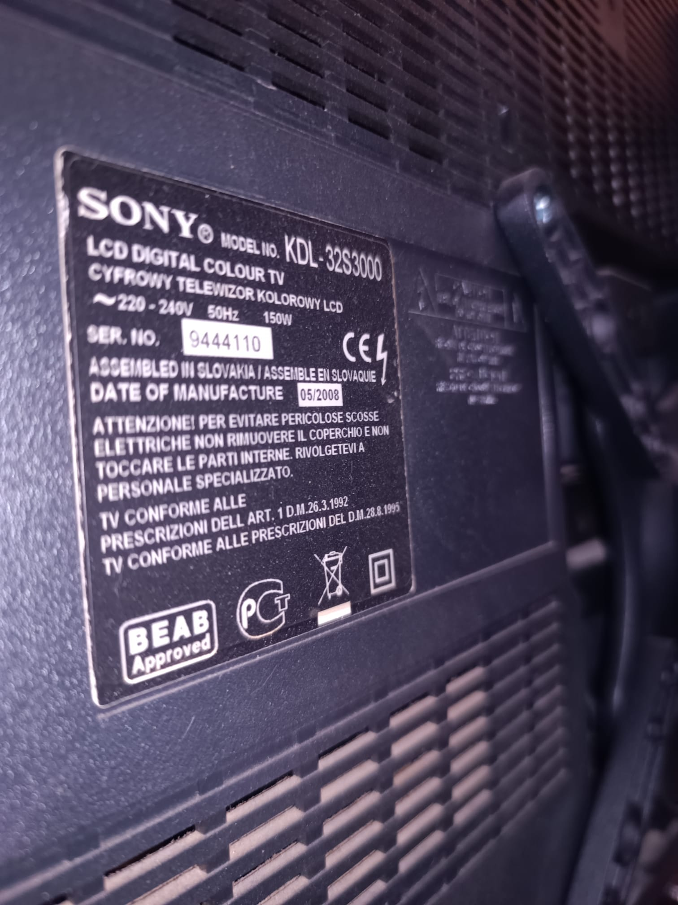
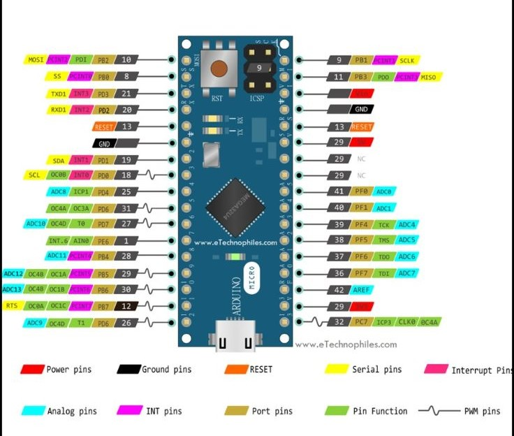
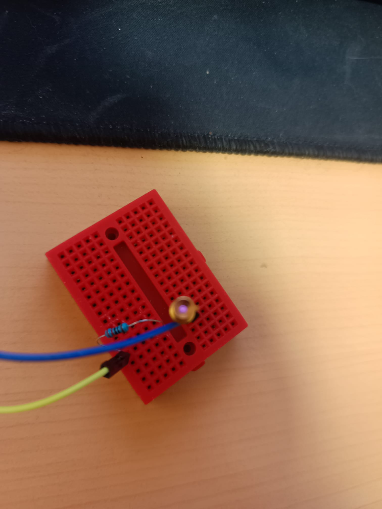
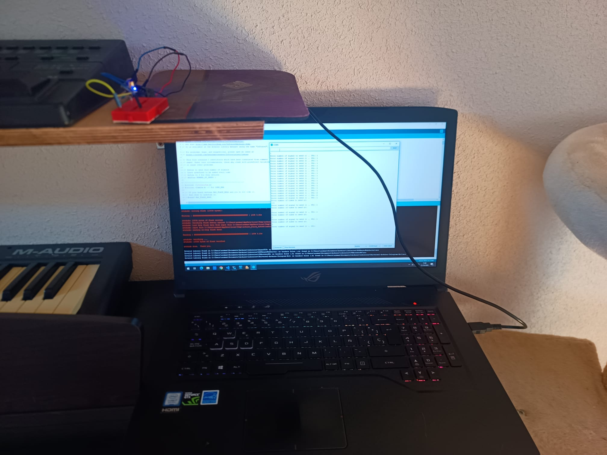
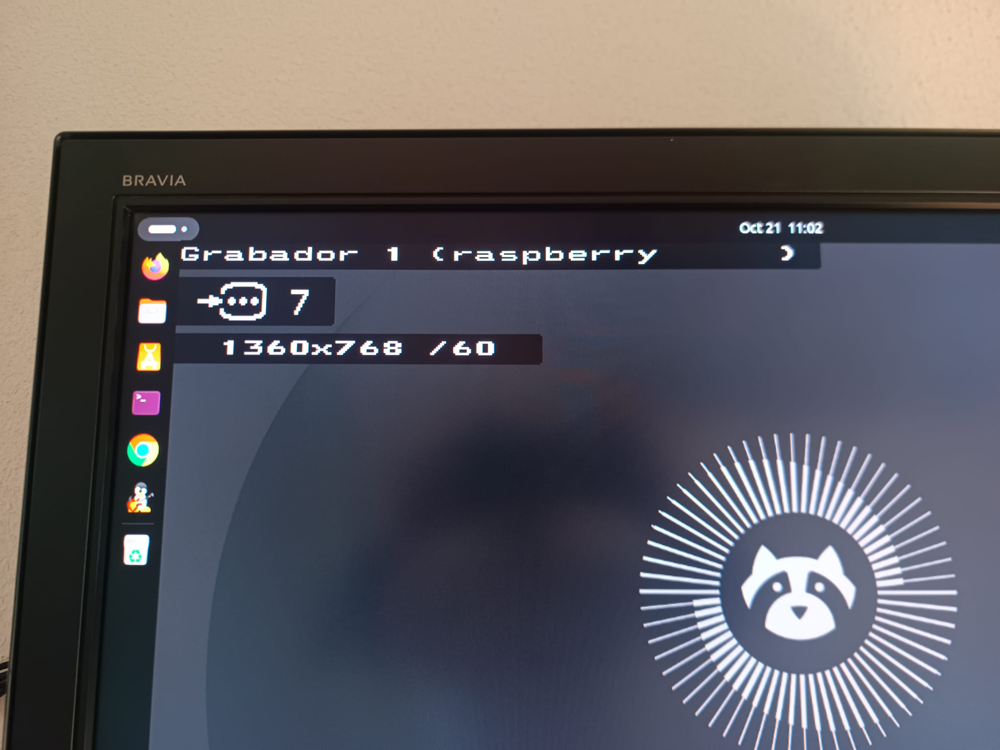
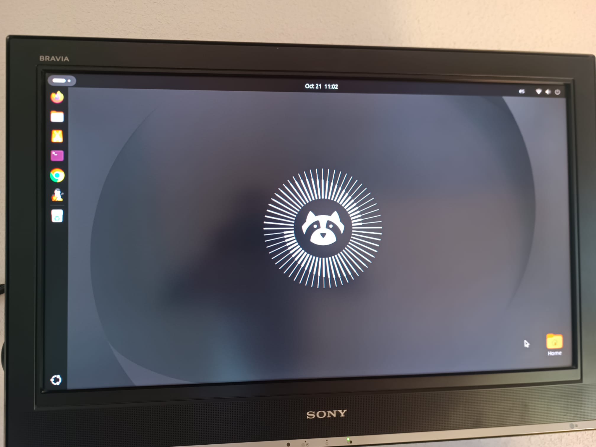

# Sony IR Remote

I don't have the TV remote, so I need to hide the info from the top (I+) so I can see the screen. The **i+** is located top left. 
Shows channel info (or HDMI data).

</img>

## Some data about the TV.

  * model SONY KDL-32S3000. [Sony TV data](https://www.sony.es/electronics/support/televisions-projectors-lcd-tvs/kdl-32s3000/specifications)
  * remote: RM-ED009. [Lirc remote database](https://lirc-remotes.sourceforge.net/remotes-table.html)

</img>

Btw, the TV was found in a trash bin, working fine.

## So, what to do ?

The idea is create a simple IR transmitter, that sends the code. Sony uses a propietary IR protocol, so
I check the Lirc database, and found [The Irdb](https://github.com/probonopd/irdb) database. I check the
remote model and button info:

```
Button i+	Protocol Sony20	26	73	84
```

But these codes are not useful. So checking the [irdb](https://github.com/probonopd/irdb) project I found an amazing project:
[IrScrutinizer](https://github.com/bengtmartensson/IrScrutinizer). This project is a ir lab to tinker with ir data, and among 
another things, does export code for arduino based on [Lirc remote database](https://lirc-remotes.sourceforge.net/remotes-table.html)
files. 

I installed **IrScrutinizer** (It's a Java app, so works multiplatform), import the remote <a href="docs/RM-ED009.lircd.conf"></a> 
[Online version](https://sourceforge.net/p/lirc-remotes/code/ci/master/tree/remotes/sony/RM-ED009.lircd.conf) configuration
file, and export it as arduino sketch. So far so good.

## Builing the remote.

The arduino sketch is generated, so we need to wire it up. First of all, I will use an arduino micro. If you check the
documentation on the generated sketch, it points to [Infrared4Arduino](https://github.com/bengtmartensson/Infrared4Arduino)
the IR library for arduino. It says that in the Arduino Micro, Sender PIN (GPIO) is 9, and Capture PIN (GPIO) is 4. We only
use Sender (XMIT) pin. 

</img>.
```
Pinout 

PIN 9 to LED IR POSITIVE
PIN GND to LED GND
```

To compile the sketch, use the Arduino Micro Board, and install (from manage library) the **Infrared** library.
Upload, and set the serial baud to `115200`. Here is the script: [irduino.ino](irduino/irduino.ino)

**HINT**: to test the circuit, load `blink.ino`, change the pin to 9 (both in `setup` and `loop`) and check with
your phone camara that the led is flashing.

</img>

## Using the remote.

The library allows you to send *any* of the remote command. In our case, the command is `1`: as shown:

```C
  ...
    switch (commandno) {
    case 1:
        sendRaw(NULL, 0U, repeat_KEY_INFO, 26U, 40000UL, times);
        break;
    case 2:
  ...
```

In order to get it working, I have to comment `NUMBER_OF_SENDS` and send it as 3, (or leave it and put a 3)

</img>
 
```C
// Define to 3 for Sony devices.
// #define NUMBER_OF_SENDS 1
```

So here it is! before/after using the remote :-)

</img>
</img>

Hope you find it useful !
